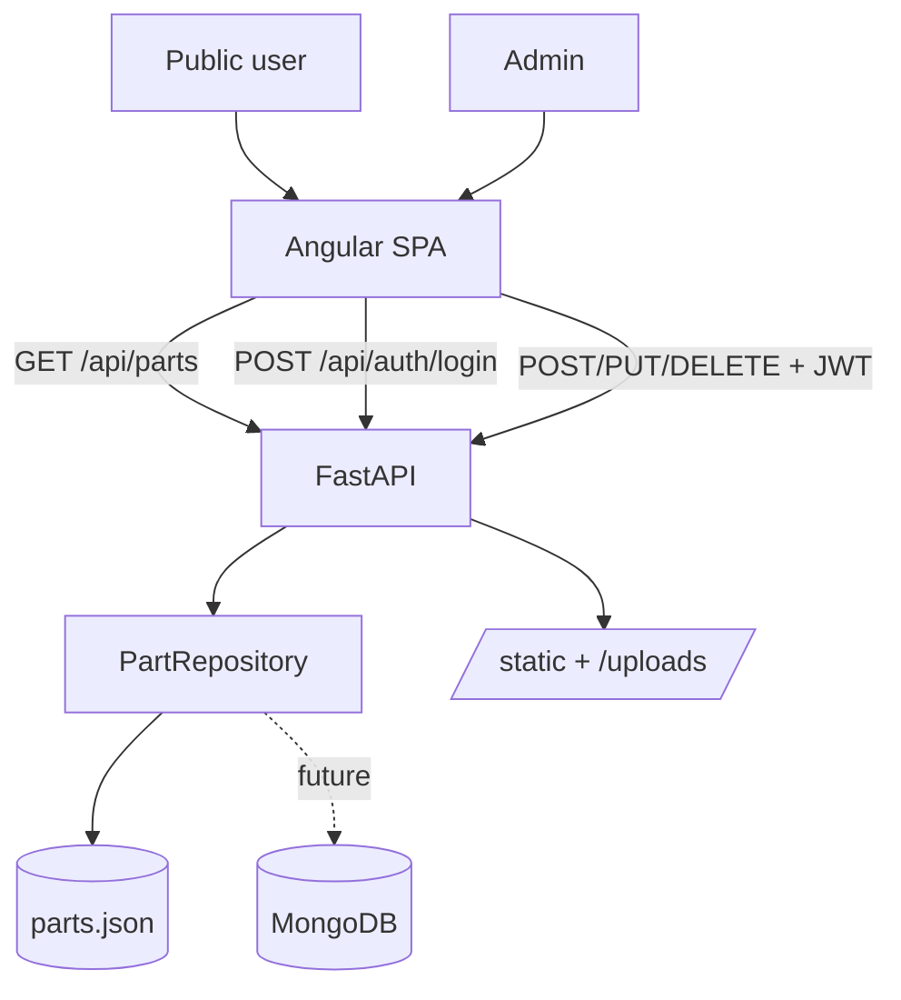

# Plan: ZHA Auto Parts Catalog

**Status:** Approved · **Stack:** Angular 18 (standalone) · FastAPI (Python 3.13) · JSON-file repository (MongoDB-ready)

## 1. Requirements
| ID | Requirement |
|----|-------------|
| FR-01 | Public users browse the parts catalog without logging in |
| FR-02 | List view: image, name, category, brand, price (₹; Rent items shown per day) |
| FR-03 | Detail view: gallery image, description, specs, compatible vehicles, price |
| FR-04 | Search, category filter, and price sort |
| FR-05 | Admin login with a static account (`admin_zha` / `zhagaram`) |
| FR-06 | Admin can add, update, and delete parts |
| FR-07 | Admin can upload a part image (jpg/png/webp, ≤ 2 MB) |
| FR-08 | Seed with 15 automobile parts + 3 rental items (Rent category) and custom SVG images |
| NFR-01 | Responsive layout for laptop (≥1024px) and mobile (≥360px) with compact spacing |
| NFR-02 | "Emerald Noir & Ivory" theme |
| NFR-03 | No MongoDB connection yet; storage can be swapped behind a repository interface |

## 2. Architecture decisions
- **AD-001** Monorepo: `frontend/` (Angular) + `backend/` (FastAPI).
- **AD-002** Repository pattern: `PartRepository` protocol → `JsonPartRepository` now (`data/parts.json`, file lock + atomic write); `MongoPartRepository` (Motor) can be added later and selected with `STORAGE=mongo`.
- **AD-003** Auth: static credentials stored in `.env`/settings with a hashed password check, plus a JWT (HS256, 2h expiry). GET endpoints are public. POST/PUT/DELETE require `Bearer` auth.
- **AD-004** Images: seed SVGs stored in `backend/static/parts/`; uploads go to `backend/uploads/` with a UUID filename and MIME and size validation. Both are served through `/static` and `/uploads`.
- **AD-005** Frontend: Angular standalone components, signals, lazy-loaded admin route, `authGuard`, and an HTTP interceptor. Styling uses SCSS and CSS variables, with no heavy UI library, to keep the layout compact.



## 3. Data model (Part)
`id (uuid)`, `name`, `sku`, `category` (Engine, Brakes, Suspension, Electrical, Filters, Lighting, Transmission, Body, Rent), `brand`, `price` (decimal ₹), `mrp`, `description`, `specs` (key/value dict), `compatibleVehicles` (list), `imageUrl`, `createdAt`, `updatedAt`.

## 4. API
| Method | Path | Auth |
|--------|------|------|
| GET | `/api/parts?search=&category=&sort=` | Public |
| GET | `/api/parts/{id}` | Public |
| GET | `/api/categories` | Public |
| POST | `/api/auth/login` | Public |
| POST | `/api/parts` | Admin |
| PUT | `/api/parts/{id}` | Admin |
| DELETE | `/api/parts/{id}` | Admin |
| POST | `/api/uploads` (multipart) | Admin |

The API uses Pydantic v2 validation with `extra="forbid"`, standard error JSON, and CORS limited to `http://localhost:4200`.

## 5. UI / theme
- **Palette:** Noir `#0E1411`, Emerald `#0F5C4A` / `#1F8A70`, Ivory `#F6F1E7`, Gold hairline `#C9A96E`
- **Typography:** Playfair Display for headings and Inter for body text.
- **Pages:** Catalog grid (4 columns on desktop, 2 on tablet, 1–2 on mobile with 12–16px gaps) · Part detail · Admin login · Admin dashboard (compact table on desktop, cards on mobile) · Add/edit part modal or form with image preview.
- **Header:** sticky header with search. The admin link appears in the footer and header icon only.

## 6. Execution tasks
**Phase 1 – Foundation**
- T-001 Scaffold `backend/` (FastAPI, uv/pip, settings, CORS, health route)
- T-002 Scaffold `frontend/` (`ng new`, routing, SCSS theme tokens, fonts)

**Phase 2 – Backend**
- T-003 Part models and `PartRepository` + `JsonPartRepository`
- T-004 Seed data: 15 parts + 15 custom SVG images (brake disc, spark plug, oil filter, headlight, battery, clutch plate, shock absorber, air filter, alternator, radiator, timing belt, wiper blade, brake pad, side mirror, gear knob)
- T-005 Public read endpoints with search, filter, and sort
- T-006 Login + JWT + admin dependency
- T-007 CRUD + image upload endpoints
- T-008 pytest tests for repository, auth, and CRUD

**Phase 3 – Frontend**
- T-009 Theme, layout shell, header, and footer (responsive)
- T-010 Catalog page: cards, search, category chips, and sort
- T-011 Part detail page
- T-012 Auth service, interceptor, guard, and login page
- T-013 Admin dashboard: list, delete confirmation, and add/edit form with upload
- T-014 Loading, empty, error, and toast states

**Phase 4 – Verify & run**
- T-015 Responsive check at 375px and 1366px with Playwright screenshots
- T-016 README with run commands (`uvicorn` on :8000, `ng serve` on :4200, proxy `/api`)

```
T-001 → T-003 → T-004/T-005/T-006 → T-007 → T-008
T-002 → T-009 → T-010 → T-011 ; T-006 → T-012 → T-013 → T-014 → T-015 → T-016
```

## 7. Risks
| Risk | Mitigation |
|------|-----------|
| Static credentials in code | Store them in `.env` (git-ignored) with defaults only for local development, compare hashes, and document this as a local/demo setting |
| JSON file corruption with concurrent writes | Use a process lock + atomic temp-file rename. This setup supports a single instance only until MongoDB is added |
| Unsafe uploads | Use an extension and MIME allowlist, a 2 MB limit, UUID filenames, and no SVG uploads to prevent XSS |

## 8. Definition of Done
- Public users can browse, search, and view details on mobile and laptop.
- The admin can log in and add, edit, and delete parts, and changes persist after a restart.
- pytest passes and `ng build` succeeds.

## Change log
- 2026-11-14: Removed stock from model and UI. Added a **Rent** category; its price is per day and MRP does not apply.

- 2026-11-14: Rebranded to **ZHAGARAM Jewellery** (imitation/fashion jewellery). New categories: Necklaces, Earrings, Rings, Bangles, Bracelets, Pendants, Anklets, Nose Pins, Mangalsutra, Bridal Sets, Rent. Removed compatible-vehicles field. 19 new seed designs and SVG illustrations.
- 2026-11-14: MongoDB storage layer (categories, items, images as binary) selected by MONGO_URI, with JSON-file fallback; images served from DB via /api/images/{id} (static files removed); admin category management (add/rename/delete, rental flag); public image download on detail page; export/import tool + mongo-export/ JSON; legacy data auto-migrated.
